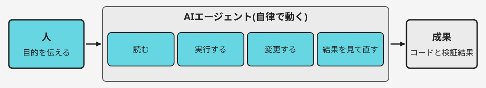
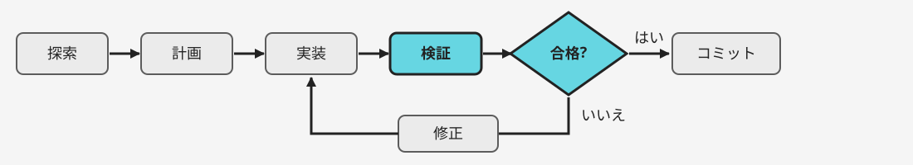
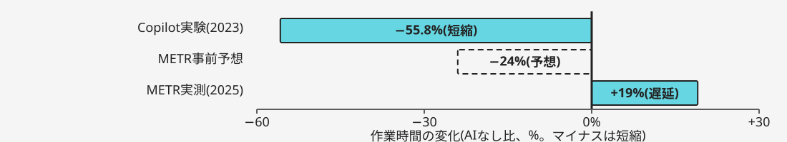
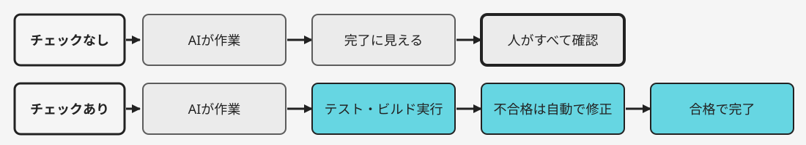
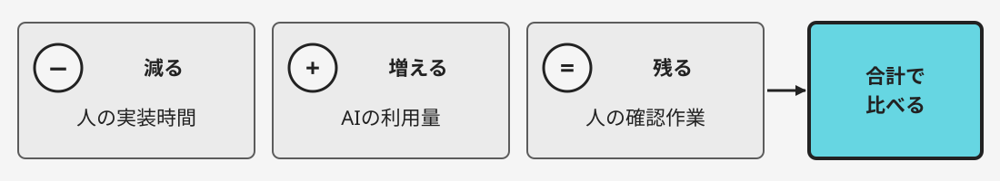
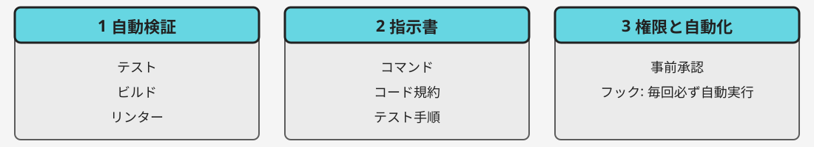
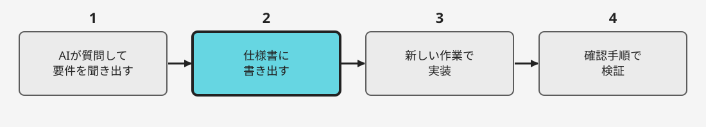
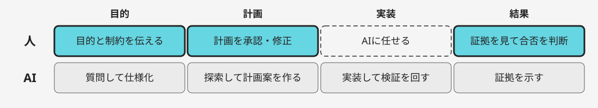
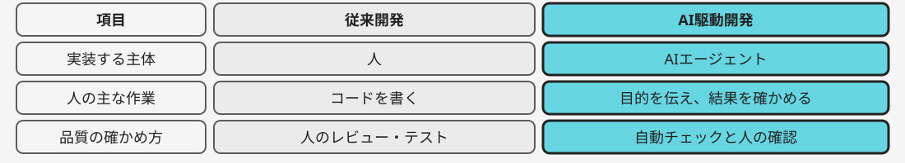
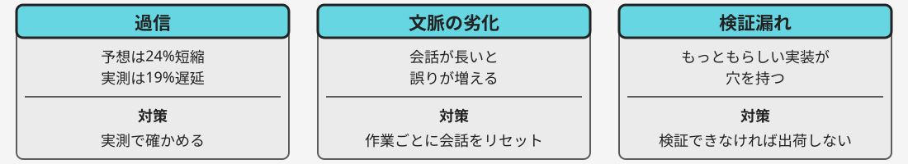

# AI駆動開発の手法と効果

手法・QCDへの効果・準備・人の役割・従来開発との違い

---

# 効果は人の検証で決まる

---

## AI駆動開発は検証の仕組みで効果が決まる

AIは完了に見えた時点で止まるため、確かめる仕組みが要るからです。

- 実装はAIエージェントに任せる
- 準備の中心は自動検証と指示書
- 人は目的の定義と結果の判断を担う

<small>出典: Claude Code 公式文書[[1]](#ref-1)</small>

---

# ループで開発する

---

## AI駆動開発はAIが実装まで自律で進める手法

AIエージェントは読む・実行する・直すを自律で行えるからです。

- AI駆動開発は、AIエージェントを用いたアプリ開発手法

<small>出典: Claude Code 公式文書[[1]](#ref-1)</small>

---

## ループ開発は合格まで検証を繰り返す

チェックが合格するまで、AIが作業と修正を反復できるからです。

- 小さな変更ごとに回すと誤りを早く直せる

<small>出典: Claude Code 公式文書[[1]](#ref-1)</small>

---

# QCDは条件で変わる

---

## 納期は条件しだいで短縮にも遅延にもなる

2つの実験で、作業時間の変化が正反対に分かれたからです。

- QCDは品質(Quality)・コスト(Cost)・納期(Delivery)の評価軸
- 単純な新規課題では短縮、熟練者の既存コード改修では遅延だった

<small>出典: Peng ら Copilot 実験[[2]](#ref-2)、METR 熟練開発者の実験[[3]](#ref-3)。いずれもAIエージェント単体の測定ではない</small>

---

## 品質は自動チェックの有無で変わる

チェックがないと、人が誤りを見つける役を負うからです。

- 自動チェックは、テスト・ビルドなどを実行して合否を返す仕組み
- テスト出力など証拠を示させて確認する

<small>出典: Claude Code 公式文書[[1]](#ref-1)</small>

---

## コストは人の作業とAI利用量の合計で見る

人の作業は減る一方、AIの利用量と確認作業が加わるからです。

- 会話を整理すると利用量を抑えられる

<small>出典: Claude Code 公式文書[[1]](#ref-1)、Peng ら Copilot 実験[[2]](#ref-2)。実験はAIエージェント単体の測定ではない</small>

---

# 検証と指示を整える

---

## 準備は自動検証・指示書・権限の3つ

AIが自走するには、確認手段と守る規則が先に必要だからです。

- CLAUDE.mdはAIが毎回最初に読む指示書で、短く保つ

<small>出典: Claude Code 公式文書[[1]](#ref-1)</small>

---

## 仕様は対話で固めて書き出してから任せる

仕様を先に書くと、AIが迷わず、確認の基準もできるからです。

- 仕様に対象ファイル・対象外・確認手順を入れる

<small>出典: Claude Code 公式文書[[1]](#ref-1)</small>

---

# 人は確かめる役へ

---

## 人は目的・計画・結果の3点で判断を担う

AIは成功を主張して止まるため、判断は人が持つ必要があるからです。

- AIが誤った方向へ進んだら人が早く止めて直す

<small>出典: Claude Code 公式文書[[1]](#ref-1)</small>

---

## 従来は人が書き、AI駆動では人が確かめる

実装の主体がAIに移り、人の作業の中心が変わるからです。

- 書く量は減るが、確かめる責任は残る

<small>出典: Claude Code 公式文書[[1]](#ref-1)</small>

---

## 注意点は過信・文脈の劣化・検証漏れ

3つとも実験または公式文書で指摘された失敗だからです。

- コンテキストは、AIが保持する会話とファイルの全体

<small>出典: METR 熟練開発者の実験[[3]](#ref-3)、Claude Code 公式文書[[1]](#ref-1)。実験はAIエージェント単体の測定ではない</small>

---

# 小さく検証を試す

---

## まず小さな課題で検証ループを試す

効果を得る鍵は、AIの使い方より確かめる仕組みと人の判断だからです。

- 自動チェックを1つ用意する
- 小さな課題で仕様を書いてAIに任せる
- 作業時間と手戻りを測り、人の確認範囲を決める

---

## 参考文献

1. [Claude Code のベストプラクティス(公式文書)](https://code.claude.com/docs/ja/best-practices)(2026年10月取得)
2. [Peng ら「The Impact of AI on Developer Productivity: Evidence from GitHub Copilot」(英語版、2023年)](https://arxiv.org/abs/2302.06590)(2026年10月取得)
3. [METR「Early-2025 AI Experienced OS Dev Study」(英語版、2025年)](https://metr.org/blog/2025-07-10-early-2025-ai-experienced-os-dev-study/)(2026年10月取得)
